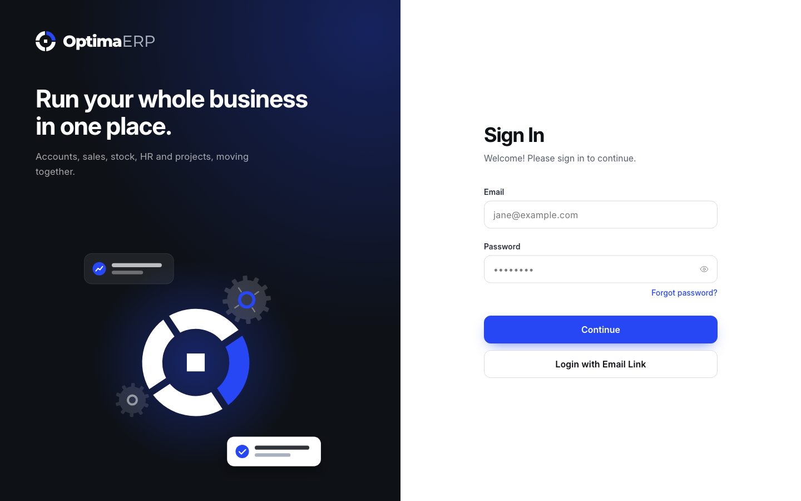
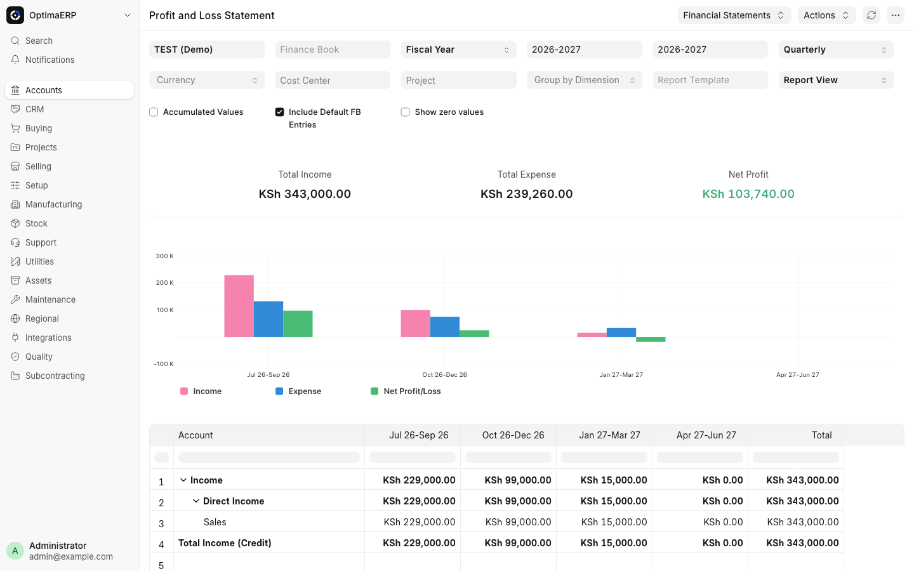
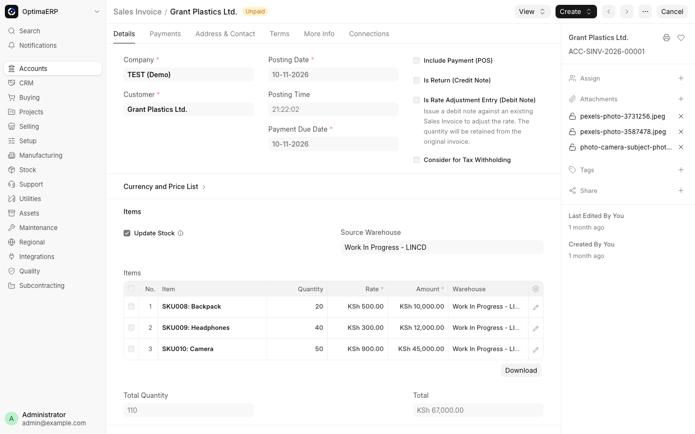
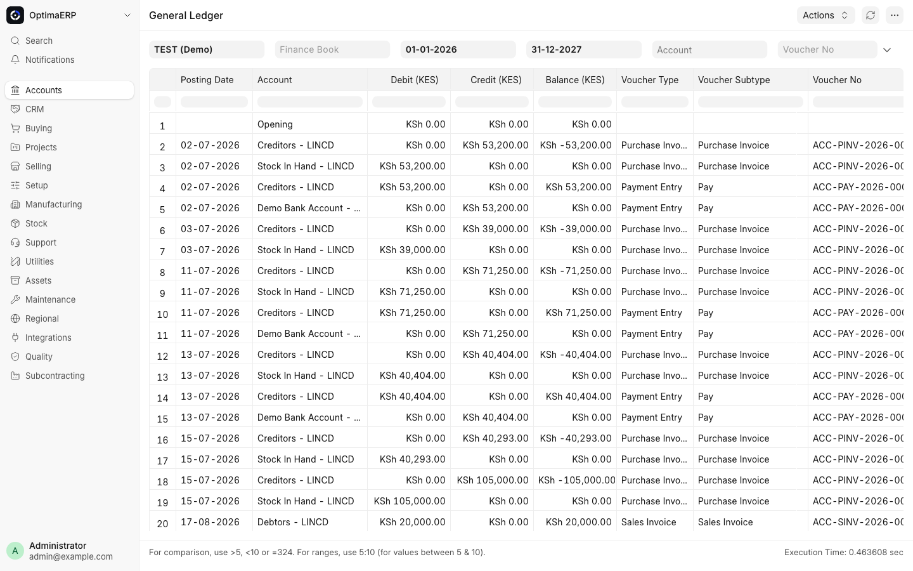
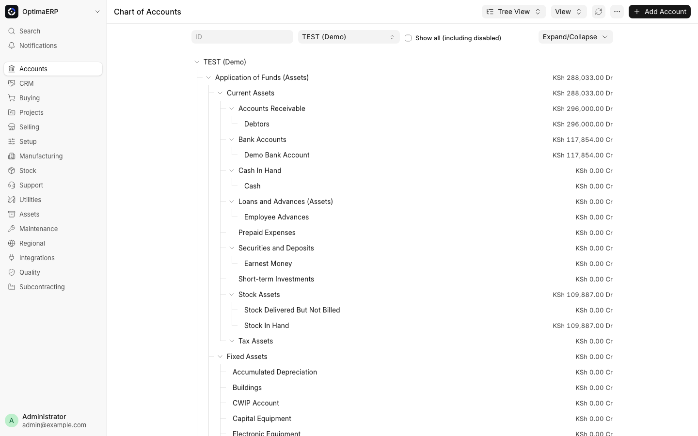
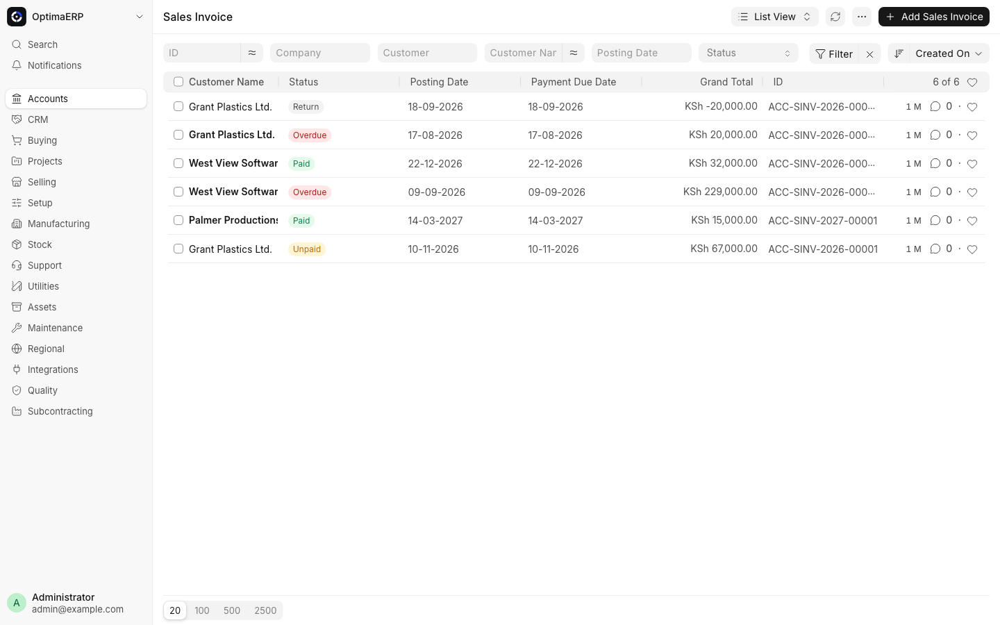
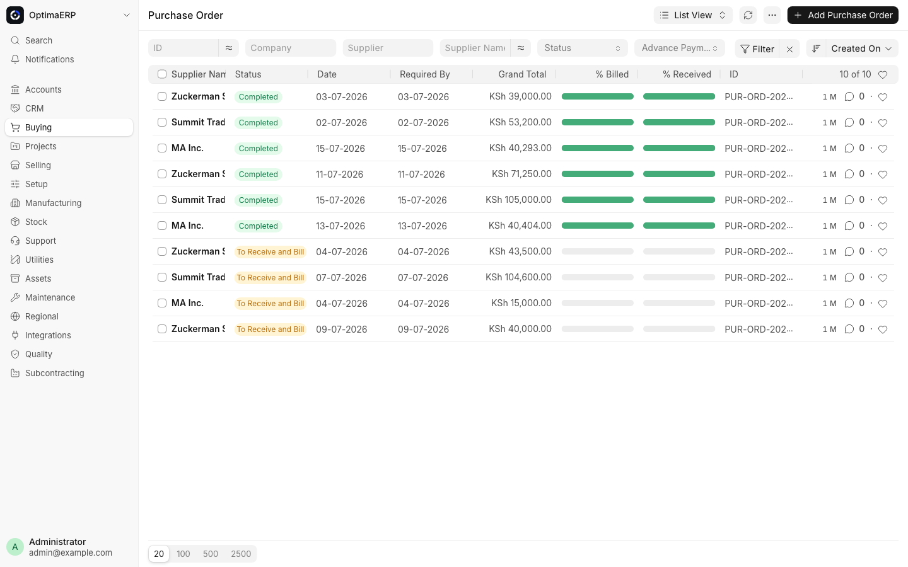
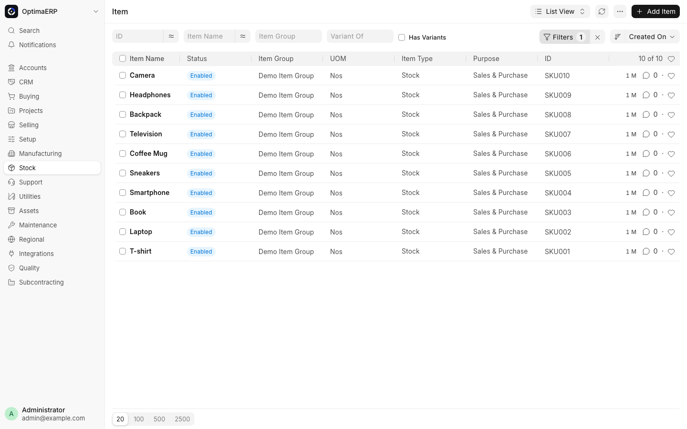
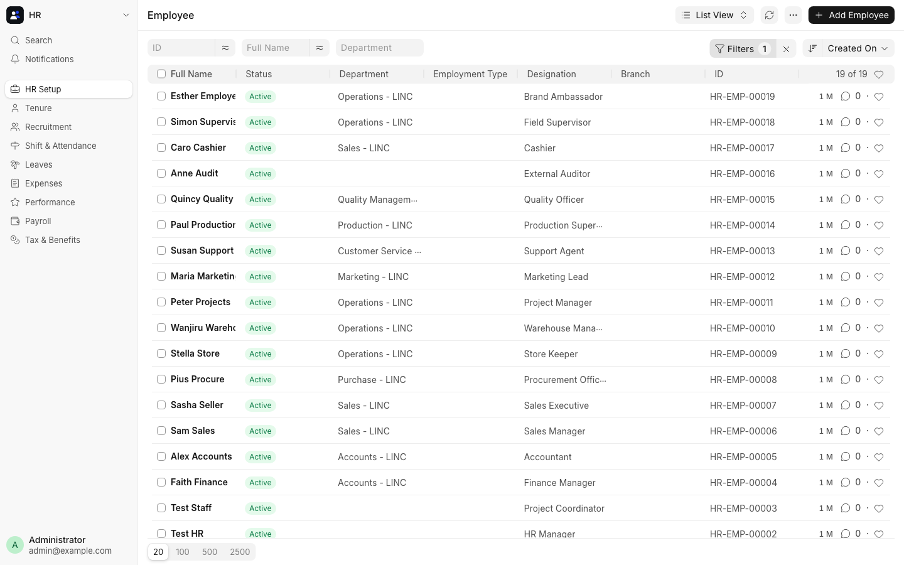

<p align="center">
  <picture>
    <source media="(prefers-color-scheme: dark)" srcset="optimaerp/public/images/optimaerp-wordmark-dark.svg">
    
  </picture>
</p>

<p align="center"><strong>One system for the whole business.</strong><br>Accounting, stock, selling, buying, manufacturing, projects, CRM and HR, on one ledger and one login.</p>

<p align="center">
  
  
  
  
  <a href="license.txt"></a>
  <a href="#work-with-me"></a>
</p>

<p align="center">
  <a href="#screenshots">Screenshots</a> |
  <a href="#whats-inside">What's inside</a> |
  <a href="#quick-start">Quick start</a> |
  <a href="#demo-users">Demo users</a> |
  <a href="#work-with-me">Work with me</a>
</p>



> **Need an ERP set up or customised for your business?** I install OptimaERP, configure it around how your company works, build custom modules and integrations, and train your team. [Get in touch →](#work-with-me)

OptimaERP is a full ERP for small and growing businesses, built on [ERPNext](https://github.com/frappe/erpnext) and the [Frappe Framework](https://github.com/frappe/frappe). Every department works in the same database: a sales invoice posts to the general ledger the moment it is submitted, a delivery moves stock and its value together, and a timesheet can bill straight to the customer. Roles decide who can see, create, approve and export each document, and every change keeps a version history.

OptimaERP ships the complete ERPNext v17 feature set under its own name and brand. The Python package, JavaScript namespace, assets and integrations module are renamed from `erpnext` to `optimaerp`, and the interface, sign-in page, loader and emails carry the OptimaERP identity.

## Screenshots

<table>
  <tr>
    <td width="50%"><br><sub><b>Profit and loss</b>: income, expense and net profit by quarter, straight from the ledger</sub></td>
    <td width="50%"><br><sub><b>Sales invoice</b>: one document bills the customer, moves the stock and posts to the ledger</sub></td>
  </tr>
  <tr>
    <td width="50%"><br><sub><b>General ledger</b>: every debit and credit, traced back to the invoice or payment behind it</sub></td>
    <td width="50%"><br><sub><b>Chart of accounts</b>: a full account tree with live balances</sub></td>
  </tr>
  <tr>
    <td width="50%"><br><sub><b>Sales</b>: invoices with paid, unpaid, overdue and return status at a glance</sub></td>
    <td width="50%"><br><sub><b>Buying</b>: purchase orders with billed and received progress</sub></td>
  </tr>
  <tr>
    <td width="50%"><br><sub><b>Stock</b>: items, item groups and units, tracked across warehouses</sub></td>
    <td width="50%"><br><sub><b>People</b>: employees by department and designation, linked to their sign-ins</sub></td>
  </tr>
</table>

## What's inside

### What OptimaERP adds

- **Its own brand, everywhere:** logo, wordmark, favicon, desk app icon, browser tab title and email header. The app is `optimaerp` in code as well as on screen.
- **A redesigned sign-in page:** a split layout with a brand panel, set in the OptimaERP colours.
- **A ring loader:** after sign-in, the logo's ring spins on the page while the desk loads, in light and dark themes, with a calmer pulse for people who turn off motion.
- **Logos set on install:** a new site gets the OptimaERP logos in Website Settings and Navbar Settings automatically. A logo you have already set is never overwritten, and a patch brings existing sites up to date.
- **Developed on PostgreSQL:** the development site runs on PostgreSQL every day, and MariaDB works as it does in ERPNext.

### Core features

- **Accounting:** double-entry general ledger, multiple companies and currencies, cost centres and accounting dimensions, budgets, tax templates, bank and payment reconciliation, period closing, and profit and loss, balance sheet and cash flow statements.
- **Stock:** items and variants, multiple warehouses, batches and serial numbers, perpetual inventory that posts stock value to the ledger, FIFO and moving-average valuation, reorder levels and stock reconciliation.
- **Selling and CRM:** leads, opportunities, quotations, sales orders, delivery notes, sales invoices, pricing rules, a point of sale and a customer portal.
- **Buying:** material requests, requests for quotation, supplier quotations, purchase orders, receipts and invoices, and a supplier portal.
- **Manufacturing:** multi-level bills of materials, work orders, job cards, workstations and operations, production planning and subcontracting.
- **Projects and service:** projects, tasks, timesheets billed to customers, project costing, issues, service level agreements and maintenance visits.
- **People:** employees, attendance, shifts, leave, expense claims, payroll, appraisals and recruitment, through Frappe HR.
- **Platform:** role and user permissions, approval workflows, document version history, print formats, report builder, dashboards, a REST API and webhooks.

### Modules

| Area | Modules |
| --- | --- |
| Finance | Accounting, Invoicing, Payments, Financial Reports, Assets |
| Sales | CRM, Selling, Point of Sale, Customer Portal |
| Supply chain | Buying, Stock, Subcontracting, Quality Management |
| Production | Manufacturing, Maintenance |
| Projects and service | Projects, Support |
| People | HR, Shift & Attendance, Leaves, Expenses, Payroll, Tax & Benefits, Performance, Recruitment |
| Platform | Users, Automation, Email, Telephony, Printing, Website, Integrations, EDI, Bulk Transactions |

## Quick start

Requirements: Python 3.14, Node 24+, Yarn 1.x, Redis, and PostgreSQL or MariaDB. Set up [Frappe Bench](https://github.com/frappe/bench) first.

```sh
bench init optimaerp-bench --frappe-branch develop --python python3.14
cd optimaerp-bench
bench get-app https://github.com/Lincoln-Madaraka/erpnext.git --branch main
```

The app installs as `optimaerp`. Create a dedicated site and database for it. Never point OptimaERP at another application's database.

```sh
bench new-site optimaerp.localhost --db-type postgres
bench --site optimaerp.localhost install-app optimaerp
bench --site optimaerp.localhost set-config developer_mode 1
bench use optimaerp.localhost
bench start
```

Open **http://optimaerp.localhost:8000** and sign in as `Administrator` with the password you chose in `new-site`. The setup wizard then creates your company, chart of accounts, fiscal year and currency.

For MariaDB, drop `--db-type postgres`. If port 8000 is taken, change `webserver_port` in `sites/common_site_config.json` and the `web` line in `Procfile`.

> **Frappe compatibility.** Frappe still names `erpnext` in a few places: the setup-complete check (`frappe/__init__.py`), the installed-applications setup status, the billing bundle's list of desk apps and the legacy Gravatar clean-up. The development bench runs Frappe `develop` with those references switched to `optimaerp`. Make the same change in your Frappe checkout so Frappe treats OptimaERP the way it treats ERPNext during setup.

## Demo users

The demo company has a sign-in for every role, so each screen can be shown from the point of view of the person who uses it.

| Account | Email | Access |
| --- | --- | --- |
| Superadmin | `superadmin@example.com` | System Manager across every module |
| Chief executive | `ceo@example.com` | Read, report and export across sales, buying, stock, finance, projects and HR |
| HR manager | `hr@example.com` | HR, attendance, leave, expenses and payroll; opens in the HR app |
| Staff | `staff@example.com` | Employee self-service and project work, limited to their own employee record |
| Finance manager | `finance.manager@example.com` | Accounting, with manager rights |
| Accountant | `accountant@example.com` | Accounting entries and reports |
| Sales manager | `sales.manager@example.com` | Selling and CRM, with manager rights |
| Sales executive | `sales.exec@example.com` | Quotations, orders and customers |
| Procurement officer | `procurement@example.com` | Buying, with manager rights |
| Storekeeper | `storekeeper@example.com` | Stock transactions |
| Warehouse manager | `warehouse.manager@example.com` | Stock and item master data, with manager rights |
| Project manager | `project.manager@example.com` | Projects, tasks and timesheets, with manager rights |
| Marketing lead | `marketing@example.com` | Campaigns, leads and selling |
| Support agent | `support@example.com` | Issues and service level agreements |
| Production supervisor | `production@example.com` | Manufacturing and the stock it consumes |
| Quality officer | `quality@example.com` | Quality goals, procedures, inspections and reviews |
| Auditor | `auditor@example.com` | Read-only auditor access |
| Cashier | `cashier@example.com` | Point of sale and payments, limited to their own record |
| Field supervisor | `supervisor@example.com` | Project work and leave approval for the team |
| Employee (self-service) | `ess.employee@example.com` | Employee Self Service only |
| Client portal | `client.portal@example.com` | Customer portal for one customer's orders and invoices |
| Supplier portal | `supplier.portal@example.com` | Supplier portal for one supplier's orders and quotations |

The demo roster is built by scripts that live outside this repository, and its passwords are never committed. [Ask me](#work-with-me) for a walkthrough or access to the demo site.

## Configuration

### Email (Gmail SMTP)

1. Turn on 2-Step Verification for the Google account that will send mail.
2. Create an App Password at <https://myaccount.google.com/apppasswords>.
3. In OptimaERP, open **Email Account › New**, choose the **GMail** service, enter the Gmail address and the 16-character App Password without spaces, and tick **Enable Outgoing** and **Default Outgoing**.
4. Tick **Enable Incoming** too if replies should land on the documents they answer.

Gmail limits personal accounts to roughly 500 messages a day, so use Google Workspace or a transactional provider for real volume.

### Branding

All brand files live in `optimaerp/public/images`:

| File | Used for |
| --- | --- |
| `optimaerp-icon.svg` | Desk app icon and navbar corner (dark tile, readable on the light desk) |
| `optimaerp-icon-small.svg` | Favicon |
| `optimaerp-wordmark.svg` / `.png` | Sign-in page, website navbar and email header (PNG, as mail clients drop SVG) |
| `optimaerp-wordmark-dark.svg` | Wordmark for dark backgrounds |
| `optimaerp-loader.svg` | Fallback loader image |

`hooks.py` points Frappe at the icons. `optimaerp.setup.install.set_app_logos` fills the logo fields on install, and the post-sign-in loader is `optimaerp/templates/includes/splash_screen.html`, which replaces Frappe's version. To re-brand for a client, swap these files and keep their names, then run `bench build --app optimaerp`.

### Port and site

The development bench serves on port 8000 by default, with the site `optimaerp.localhost`. On a machine where another app already uses port 8000, set `webserver_port` in `sites/common_site_config.json` and update the `web` line in `Procfile` to match.

## How it's built

```text
optimaerp/
  accounts/  stock/  selling/  buying/  manufacturing/  projects/
  crm/  assets/  support/  quality_management/  subcontracting/  ...
                           one Frappe module per business area: DocTypes, reports, workspaces
  hooks.py                 app wiring: icons, loader, document events, scheduler
  setup/install.py         after-install defaults: app name, logos, roles
  patches.txt              ordered data migrations, run by `bench migrate`
  public/images/           logo, wordmark, favicon, loader
  public/scss/             desk, sign-in, website and email styles
  templates/includes/      splash_screen.html (overrides Frappe's loader)
  modules.txt              the 21 modules this app registers
```

- Every business object is a DocType: a JSON schema plus a Python controller and a JavaScript form script, side by side in its module folder.
- Accounting and stock postings run in the controllers' `on_submit` and `on_cancel`, so a submitted document and its ledger entries always agree. Submitted documents are cancelled and amended, never edited in place.
- Permissions come from roles on each DocType, narrowed per record by user permissions.
- HR and payroll come from Frappe HR (`hrms`), a separate app. The development bench runs a copy adapted to depend on `optimaerp` instead of `erpnext`.

## Checks

```sh
bench --site optimaerp.localhost run-tests --app optimaerp
bench --site optimaerp.localhost run-tests --app optimaerp --module optimaerp.accounts.doctype.sales_invoice.test_sales_invoice
pre-commit run --all-files
bench build --app optimaerp
```

Run tests against a dedicated test site, never a site that holds real business data. `pre-commit` runs Ruff, Prettier, ESLint and a static PostgreSQL compatibility check that flags MySQL-only SQL.

## License and credits

OptimaERP is free software under the [GNU General Public License v3](license.txt), the same license as ERPNext. It is built on [ERPNext](https://github.com/frappe/erpnext) and the [Frappe Framework](https://github.com/frappe/frappe) by Frappe Technologies and their contributors, whose commit history this repository keeps.

ERPNext and Frappe are trademarks of Frappe Technologies. OptimaERP is an independent distribution and is not affiliated with or endorsed by Frappe Technologies. See the [trademark policy](TRADEMARK_POLICY.md).

## Work with me

OptimaERP is maintained by **Lincoln**, a full-stack developer. I'm open to freelance gigs, contract work and full-time roles, including:

- **ERP rollouts:** installing OptimaERP on your servers, setting up your companies, chart of accounts, taxes and roles, importing your existing data and training your team.
- **Custom modules:** new documents, approval workflows, print formats, dashboards and reports shaped around how your business works.
- **Integrations:** payment gateways, SMS and WhatsApp, accounting exports, webhooks and third-party APIs.
- **Frappe and Laravel consulting:** architecture reviews, performance work, testing and shipping features with your team.

**WhatsApp:** [+254 759 725 607](https://wa.me/254759725607?text=Hi%20Lincoln%2C%20I%20saw%20OptimaERP) (fastest way to reach me)

**Email:** [madarakalincoln48@gmail.com](mailto:madarakalincoln48@gmail.com?subject=OptimaERP%20enquiry) | **GitHub:** [Lincoln-Madaraka](https://github.com/Lincoln-Madaraka)

If OptimaERP is useful to you, a star on the repository helps others find it.
